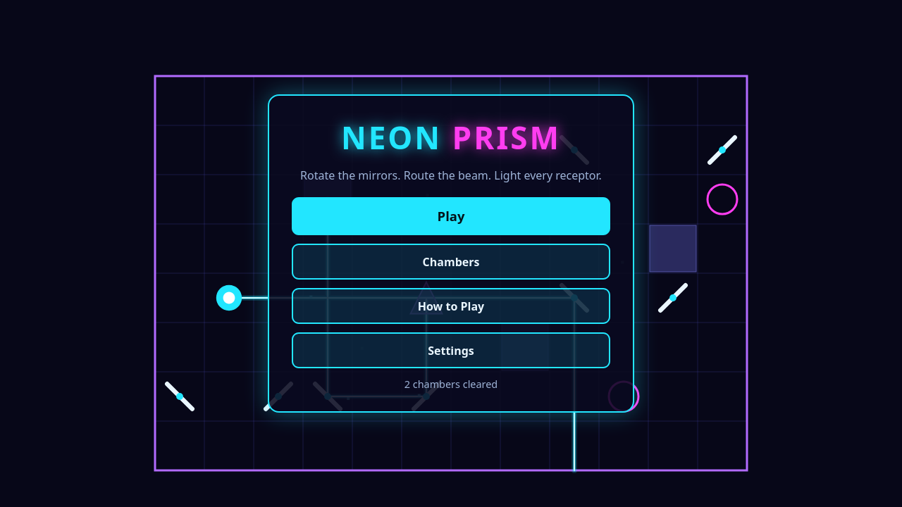
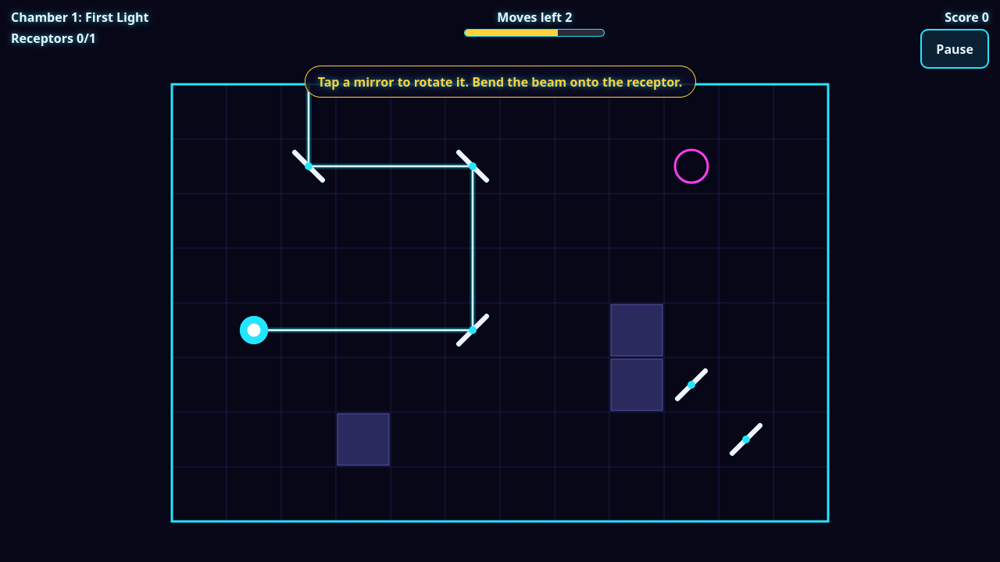

# Neon Prism

A 2D neon laser-mirror puzzle. Rotate mirrors to steer a laser beam through prisms and light every receptor in the chamber — within the move budget.

**Play:** https://namdev-muse.github.io/neon-prism/

## How to play

- Tap or click a **mirror** to rotate it (`/` ↔ `\`). Mirrors bend the beam 90°.
- **Prisms** split the beam in two — straight on, and turned clockwise.
- **Walls** stop the beam. **Receptors** light when the beam passes through them.
- Light **every receptor at once** to clear the chamber. Each rotation costs a move — run out and the chamber fails.
- Score rewards clearing, move efficiency, and speed — the clear screen breaks the total down (Clear + Efficiency + Time). Best score and rank (S/A/B) are saved per chamber.
- Every rotation snaps with sparks and a micro-shake; the beam throws sparks where it dies on a wall; lighting a receptor lifts the generative music an octave.
- Keyboard: arrows or Tab select a mirror, Space rotates, R resets, P pauses, M mutes. Touch: tap mirrors directly.

## Chambers

| # | Chamber | Receptors | Par moves | Budget |
|---|---------|-----------|-----------|--------|
| 1 | First Light | 1 | 2 | 3 |
| 2 | Crossbeam | 2 | 3 | 4 |
| 3 | Prism Split | 2 | 4 | 5 |
| 4 | Serpent | 1 | 5 | 6 |
| 5 | Twin Branches | 2 | 6 | 7 |
| 6 | The Gauntlet | 2 | 7 | 8 |
| 7 | Prism Crossfire | 2 | 8 | 9 |
| 8 | Switchback | 2 | 9 | 10 |
| 9 | The Circuit | 2 | 10 | 11 |
| 10 | Serpent King | 2 | 11 | 12 |
| 11 | Triple Split | 3 | 12 | 13 |
| 12 | Void Crown | 3 | 13 | 14 |

## Tech

Vanilla Canvas 2D + Web Audio synth SFX, no build step. Pure sim in `physics.js` (beam trace, solver), presentation in `game.js`. Tests: `npm test` (smoke + bot gates), `npm run render-check`, `npm run screenshots`.

## Development

Built milestone by milestone (quality over quantity): each milestone ships only when playtested fun in a real browser. See `docs/DEVLOG.md`.

## License

MIT
